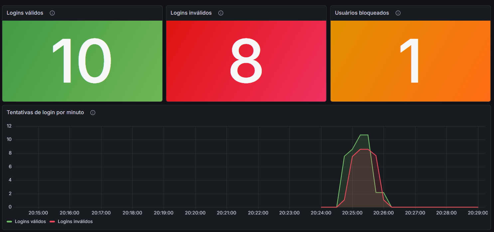

# Login Service: MS-AV-02 Segurança e Observabilidade

Serviço REST em Spring Boot com login, bloqueio após falhas seguidas,
controle de acesso por roles (`JdbcUserDetailsManager`), métricas no
Prometheus, dashboard no Grafana e documentação OpenAPI/Swagger.

## Como rodar

```bash
mvn clean spring-boot:run
```

- API: `http://localhost:8080`
- Swagger: `http://localhost:8080/swagger-ui.html`
- OpenAPI (JSON): `http://localhost:8080/v3/api-docs`
- Métricas: `http://localhost:8080/actuator/prometheus`
- H2: `http://localhost:8080/h2-console` (JDBC URL `jdbc:h2:mem:logindb`, usuário `sa`, senha `password`)

Para rodar os testes automatizados (cobrem todas as regras do enunciado):

```bash
mvn test
```

## Endpoints

| Método | Rota | Acesso | Descrição |
|---|---|---|---|
| POST | `/login` | público | `{"username","senha"}` → 200 ou 401 |
| PUT | `/trocarsenha/{userid}` | público | `{"atual","nova"}` → confere a senha atual |
| POST | `/` | `ROLE_MANUTENCAO` | cadastra usuário `{"username","senha"}` |
| GET | `/` | `ROLE_MANUTENCAO` | lista usuários (sem a senha) |
| PUT | `/unlock/{userid}` | `ROLE_ADMIN` | desbloqueia usuário |

## Usuários de teste

**Usuários do sistema** (tabela `usuarios`, usados no `/login`):
`joao/123456`, `maria/abc123`, `pedro/senha1`, `ana/ana2026`

**Operadores da API** (tabelas `users`/`authorities` do `JdbcUserDetailsManager`, via HTTP Basic):

| Usuário | Senha | Role |
|---|---|---|
| `manutencao` | `manutencao` | `ROLE_MANUTENCAO` |
| `admin` | `admin` | `ROLE_ADMIN` |

O arquivo `requests.http` tem todas as chamadas prontas (extensão REST Client do VSCode).

## Regras implementadas

- **Bloqueio:** na 2ª falha seguida o usuário fica com `locked = true` na
  tabela `login_attempts` e passa a receber 401 mesmo com a senha certa,
  até um admin chamar `PUT /unlock/{userid}`. Um login certo antes do
  bloqueio zera o contador. O limite fica em
  `app.login.tentativas-para-bloqueio`.
- **Troca de senha:** só aceita se a senha atual conferir e o usuário não
  estiver bloqueado.
- **Indicadores** (`metrica/LoginMetricas.java`):
  - `login_validos_total`: contador de logins válidos
  - `login_invalidos_total`: contador de logins inválidos
  - `usuarios_bloqueados`: gauge com o total atual de bloqueados, lido da
    tabela `login_attempts` (sobe ao bloquear e desce ao desbloquear)

## Prometheus e Grafana

Arquivos em `observabilidade/`.

**Com Docker** (sobe tudo já configurado, inclusive o dashboard):

```bash
cd observabilidade
docker compose up -d
```

- Prometheus: `http://localhost:9090`
- Grafana: `http://localhost:3000` (`admin`/`admin`) → Dashboards → **Login Service - Segurança**

**Sem Docker** (instalação local, como no material da aula):

1. Em `observabilidade/prometheus.yml`, troque o target para `localhost:8080`
2. Inicie o Prometheus com esse arquivo
3. No Grafana, crie a conexão com o Prometheus em `http://localhost:9090`
4. Dashboards → New → Import → envie `observabilidade/grafana/dashboards/login-dashboard.json`
   (exportado do Grafana 13 no formato v2; use o Grafana 13 ou mais novo)

## Dashboard



O dashboard exportado do Grafana está em
`observabilidade/grafana/dashboards/login-dashboard.json`.

## Observações

- O script SQL do enunciado tinha uma vírgula sobrando depois de
  `updated_at` na tabela `login_attempts`, o que dava erro de sintaxe.
  No `data.sql` ela foi removida.
- O `formLogin()` do Spring Security não foi habilitado porque ele cria o
  próprio `POST /login`, que conflitaria com o endpoint pedido.
- A senha não aparece no `GET /` (`@JsonProperty(WRITE_ONLY)`).
